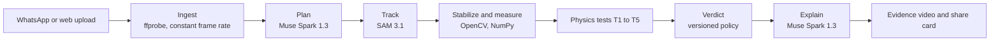

# Pisa

**AI can fake pixels. It can't fake physics.**

Pisa is a reality check for viral videos. Forward a suspicious clip on WhatsApp or upload it on the web, and within a minute Pisa answers with:

1. **A verdict:** Physically impossible, Consistent with real physics, or Inconclusive.
2. **Evidence:** the clip with the tracked object outlined and a ghost showing where it would be under real gravity.
3. **Plain numbers:** "This bottle falls as if gravity were 4 times weaker than on Earth."

The name comes from Galileo dropping two balls from the Tower of Pisa to show that everything falls at the same rate. Pisa runs that same test on viral videos.

- **Web:** https://pisa-theta.vercel.app (English, Spanish, Simplified Chinese, Brazilian Portuguese)
- **How we know it works:** https://pisa-theta.vercel.app/en/how-we-know
- **WhatsApp:** forward a video to the Pisa test number (Meta's test numbers only reply to registered phones; see [docs/WHATSAPP.md](docs/WHATSAPP.md))

> Built for the Meta Global AI Developer Hackathon (Indie Developer track). Progress, day by day, in [docs/PROGRESS.md](docs/PROGRESS.md).

## How it works

Models plan, track and explain. **The verdict always comes from measurements.**



| Stage | Tool | Role |
|---|---|---|
| Plan | Muse Spark 1.3 | Watches the clip and returns structured JSON: events, objects to track, reference objects for scale, camera notes. |
| Track | SAM 3.1 | Segments and tracks each object through the event window, one concept phrase per request. |
| Measure | Our Python engine | Trajectories, physics tests, uncertainty and the verdict. Deterministic and unit-tested. |
| Explain | Muse Spark 1.3 | Turns the measurements into a short explanation in the user's language, using only numbers from the measurements. |
| Deliver | WhatsApp Cloud API | Receives forwarded videos and replies with the evidence. |

The physics tests prefer checks that need no scale and no time base: the shape of free fall (T1), two objects dropped together (T2), bounce energy (T3), implied gravity with a confidence interval (T4), and time-base consistency across events (T5). Details in [docs/ARCHITECTURE.md](docs/ARCHITECTURE.md).

## Why physics

- Generated videos fall with "sub-Earth" gravity, between 0.38 and 2.27 m/s² instead of 9.81, and most video models violate Galileo's principle. [arXiv:2512.02016](https://arxiv.org/abs/2512.02016)
- Asking a vision-language model does not work: a VLM tuned for physical commonsense passed 0% of clean real projectiles and bounces, while physics-informed scoring of real videos reaches 0.96 to 0.99. [Morpheus, arXiv:2504.02918](https://arxiv.org/abs/2504.02918)
- Physics-based detection is an active field (MotionPhys: 78.5% on GenBuster++ with a trained classifier). Pisa differs by returning measured, checkable evidence instead of a score. [arXiv:2608.20770](https://arxiv.org/abs/2608.20770)

## How we know it works

The eval runs labeled clips through the same pipeline users get and scores the verdicts against what each clip really is. The number that matters most is the false positive rate: real videos called impossible. Every rate is reported with its 95% Wilson interval, a calibration step tunes the verdict thresholds to keep real videos safe first, and Muse Spark is asked "Is this video real or AI-generated?" about the same clips as a baseline. The published report is on the "How we know" page and in [eval/reports](eval/reports); the method and the recording guide are in [eval/README.md](eval/README.md).

The eval already paid for itself: on rendered clips with one or two pixels of tracking jitter, it caught real throws being called impossible, and the rest detection was fixed before any real video was affected.

## Scope

- **Checks:** falls, throws, bounces, and two objects falling together.
- **Does not check:** face swaps, lip-sync or cloned voices.
- **Inconclusive is an answer.** When nothing in a clip can be measured reliably, Pisa says so instead of guessing.

## Repository

```
apps/web             Next.js app (App Router, TypeScript strict, next-intl in en, es, zh-CN, pt-BR)
services/engine      Python 3.12 engine: ingest, Meta Model API adapters, tracking, physics
packages/contracts   One JSON Schema generating TypeScript types and Pydantic models
docs                 Architecture, decisions, progress, demo script, spike reports
eval                 Dataset manifest and evaluation (clips themselves are never committed)
```

## Setup

Requires Node 24, [uv](https://docs.astral.sh/uv/) and ffmpeg.

```bash
git clone https://github.com/nanoulloa/pisa && cd pisa
cp .env.example .env
make setup
make check
```

`make help` lists every command. `make e2e` runs the browser smoke test.

Run the whole eval offline on rendered clips with known physics (free, no API calls):

```bash
make eval-synthetic
```

### Paid API calls are off by default

`PISA_PAID_CALLS_ENABLED=false` in `.env` blocks every Meta Model API request before it is sent. When enabled, every call first holds its worst-case cost against `PISA_SPEND_CAP_USD` in a ledger shared through Supabase, so every container and every local run stays under one cap. The deployed engine runs the free offline stages unless it is deployed with `make deploy-engine PAID=true`. User videos are never sent to `-contributor` tier models, which Meta may train on. Tests block all network access.

## License

[MIT](LICENSE)
