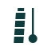

# Pisa brand

Italian modernism for a reality check: a strict grid, generous whitespace, one bold geometric mark, restrained color with one vivid accent. Everything here is generated or checked by code; `make gen` rebuilds it and `make gen-check` fails if a committed file drifts.

## Mark: Plumb

The tower leans. Gravity does not. A tower of four floors and a belfry leans four degrees, as the real one does; beside it, a sphere drops along a perfectly vertical line. It is Galileo's test in Pisa and the test Pisa runs on every video.



### Why this one

Three directions were drawn and rendered at 16, 32 and 64 px in both themes:

| Direction | Idea | Verdict |
|---|---|---|
| **Plumb** | Leaning tower beside a vertical drop line | **Chosen.** Only Pisa could own it; solid shapes survive 16 px; floors keep the tower from reading as a letter. |
| Pair | Galileo's two equal spheres landing together | Below 32 px the two drop lines read as punctuation, and nothing in it says Pisa. |
| Ghost | A shallow measured arc beside the true, steeper one | The right idea for the product's hero animation, but the dashed path vanishes below 32 px and needs color to separate the paths. |

An early Plumb drew the tower as one solid bar; next to a line ending in a dot it read as the letters "Il". Floors and a narrower belfry fixed that.

### Construction

- 64-unit grid, 4-unit module.
- Tower: four floors of 8 units and a 4-unit belfry, separated by 2-unit gaps, 44 units tall and 12 wide; belfry 8 wide.
- Every side leans exactly 4° from vertical; the base sits flat on the ground line.
- Drop line 2.5 units wide, sphere radius 5.5, on one vertical axis. The gap between tower and line closes from 10.75 units at the base to 7.7 at the top, which is how the lean reads at small sizes.
- 32 and 16 px are redrawn on the pixel grid. At 16 px the lean is a one-pixel step over twelve pixels (4.8°), the closest the grid allows.

### Use

- One color only: `pisa-mark.svg` uses `currentColor`; `pisa-mark-ink.svg` and `pisa-mark-paper.svg` are fixed.
- The app icon is the only two-color version: paper on deep teal, sphere in lime, as the ghost in the product.
- Below 48 px use the pixel cuts (`favicon-16.svg`, `favicon-32.svg`). They switch to paper in dark mode by themselves.
- Keep clear space of one sphere diameter (11 units) on every side. Never rotate the mark: the lean is already in it.
- The name "Pisa" is set separately in Cormorant Garamond italic; the mark never contains letters.

## Color

| Token | Light | Dark | Role |
|---|---|---|---|
| surface | `#FBFCFC` paper | `#0A0D0D` near-black | Page background |
| text | `#0F3D3E` deep teal | `#E8EFED` mist | Text, mark, measured points |
| text-muted | `#4D6766` | `#9EB2AF` | Captions and labels |
| action | `#14746F` teal | `#D4E64A` lime | Primary buttons and links |
| accent / ghost | `#D4E64A` lime | `#D4E64A` lime | The ghost trajectory; fills behind dark text |
| fit | `#14746F` | `#6CC8BB` | Physics fit line |
| verdict-impossible | `#A3432A` terracotta | `#EC8A6E` | Physically impossible |
| verdict-consistent | `#14746F` | `#6CC8BB` | Consistent with real physics |
| verdict-inconclusive | `#4F5F5E` | `#B3C2BF` | Inconclusive |

The full set, including surfaces for each verdict, is in [tokens.json](tokens.json) and [tokens.css](tokens.css). Dark mode sits on near-black with a trace of teal, never navy or gray.

**Terracotta** is the color of Pisa's roof tiles and of Italian earth pigments. It reads as a warning without the alarm of signal red, and sits nearly opposite teal on the color wheel, so the two verdicts never blur.

**Lime and sage on light surfaces.** As lines on paper, lime reaches 1.34:1 and sage 2.19:1, below the 3:1 charts need. So on light surfaces lime only fills behind ink text, the ghost line gets an ink edge (`--color-ghost-edge`), and sage only draws gridlines. On near-black both pass easily.

### Contrast (WCAG 2.2, computed)

| Pair | Light | Dark | Needs |
|---|---|---|---|
| Text on surface | 11.63 | 16.72 | 4.5 |
| Text on raised surface | 10.87 | 15.24 | 4.5 |
| Muted text on surface | 5.93 | 8.77 | 4.5 |
| Button label on action | 5.59 | 14.14 | 4.5 |
| Button label on action hover | 7.69 | 15.68 | 4.5 |
| Ink text on lime fill | 8.66 | 14.14 | 4.5 |
| Impossible on surface / its tint | 6.02 / 5.15 | 7.83 / 6.78 | 4.5 |
| Consistent on surface / its tint | 5.44 / 4.76 | 9.86 / 7.96 | 4.5 |
| Inconclusive on surface / its tint | 6.53 / 5.77 | 10.58 / 8.79 | 4.5 |
| Lime as a line | 1.34 (ink edge added) | 14.14 | 3 |
| Sage as a line | 2.19 (gridlines only) | 8.65 | 3 |

## Verdicts

Color is never the only signal: each verdict has its own icon, a label in words and one plain sentence.

| Verdict | Icon |
|---|---|
| Physically impossible | Circle with a diagonal bar |
| Consistent with real physics | Circle with a check |
| Inconclusive | Dashed circle with a center dot: the measurement could not close |

## Type

| Typeface | Tabular figures | Latin Extended-A | Decision |
|---|---|---|---|
| **Schibsted Grotesk** | Yes (`tnum`) | 99% | Interface, body and every number |
| **Cormorant Garamond** (italic 500) | | | The wordmark and display accents, such as the second line of the headline. Chosen by the founder over Bodoni Moda, Cinzel and Italiana. |
| Bodoni Moda | Yes (`tnum`) | 100% | First display choice, replaced by Cormorant Garamond for the wordmark |
| **Noto Sans SC** | | | Simplified Chinese, line height 1.6 against 1.5 for Latin |
| Public Sans | Yes | 97% | Alternative: clear but institutional |
| Hanken Grotesk | Default only, no `tnum` | 99% | Alternative: no proportional figures for prose |
| Instrument Sans | Yes | 77% | Set aside: thinner Latin coverage |
| Atkinson Hyperlegible Next | Yes | 73% | Set aside: thinner Latin coverage |

Figures and coverage were read from the font files with fontTools. Apply `font-variant-numeric: tabular-nums` only where digits line up (tables, measurements): in Schibsted Grotesk the feature also widens commas and colons.

## Charts

Measured points in text color, the physics fit as a line in `--color-fit`, the ghost in lime with `--color-ghost-edge` on light surfaces, gridlines in `--color-grid`. Real units on both axes, no chart junk.

## Files

```
logo/generate.py        builds every SVG below from the construction numbers
logo/pisa-mark.svg      master, currentColor
logo/pisa-mark-ink.svg  master on light
logo/pisa-mark-paper.svg master on dark
logo/favicon-16.svg     pixel cut, adapts to dark mode
logo/favicon-32.svg     pixel cut, adapts to dark mode
logo/app-icon-512.svg   app icon
logo/concept-*.svg      the three explored directions
tokens.json             token source
build_tokens.py         writes tokens.css
tokens.css              CSS custom properties, light and dark
```
