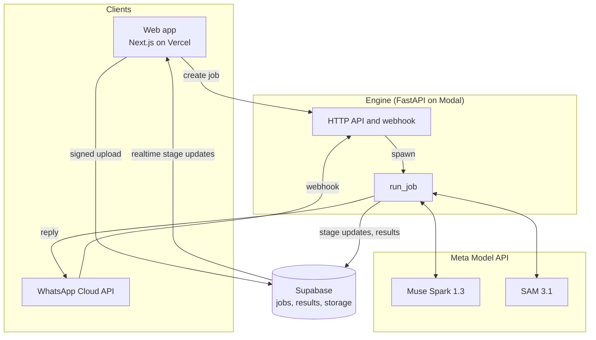

# Architecture

Pisa answers one question about a video: could real physics have produced this motion? Models plan, track and explain. Pure, tested Python code measures and decides.

## Components

Status after day 2: the whole flow (upload, ingest, track, T1, verdict, result page) runs locally, end to end in CI, and deployed, with the free color segmenter. Real SAM 3.1 calls and the WhatsApp webhook are next.

### Deployment (all on free plans, no payment method anywhere)

| Piece | Where | Notes |
|---|---|---|
| Web | Vercel, personal team `nanos-projects-ace74675`, project `pisa` (root `apps/web`), public at https://pisa-nanos-projects-ace74675.vercel.app | Deploys on every push to `main`. `NEXT_PUBLIC_ENGINE_URL` points at the engine. Vercel login protects preview branches and deployment-specific URLs; the production domains are public. |
| Engine | Modal app `pisa-engine`, `https://nanoulloa--pisa-engine-web.us-east.modal.run` | 1 CPU, at most 2 containers, scales to zero. `make deploy-engine`. Secret `pisa-engine` holds the Supabase URL and secret key and the allowed web origins. |
| Jobs and results | Supabase project `Pisa` (`supabase/migrations`) | RLS on with no policies: only the engine's secret key reads and writes. Videos never reach the database and are deleted from the engine when each job ends. |

Modal hands the engine the real client address as the connection peer and drops forged `X-Forwarded-For` headers (checked on 2026-10-26 by comparing this machine's hashed public IP with the engine's log; the logged hash has since been salted per process, so it no longer matches an unsalted hash and cannot be reversed), so the rate limiter keys on the peer.

## Pipeline

Each stage has typed inputs and outputs from `packages/contracts/schema/pisa.schema.json` and writes its result as JSON, so any stage can be re-run alone from saved artifacts.

| # | Stage | Input → output | Code |
|---|---|---|---|
| 0 | Ingest | upload → `IngestResult` (probes, `Timebase`) | `pisa_engine/ingest` |
| 1 | Plan | normalized clip → `Plan` | day 4 |
| 2 | Track | clip + phrase → `TrackSet` | `pisa_engine/tracking` |
| 3 | Stabilize | frames + object boxes → `CameraPath`, `Stabilization`, scene cuts | `pisa_engine/vision/stabilize.py` |
| 4 | Measure | stabilized tracks → flights (phases and bounces) per object and shot | `pisa_engine/physics/trajectory.py` |
| 5 | Test | flights → `TestResult` T1, T2, T3, T5 (T4 once the planner gives a scale) | `pisa_engine/physics/suite.py` |
| 6 | Verdict | `TestResult[]` → `Verdict` | `pisa_engine/verdict.py` (policy 0.1.0) |
| 7 | Explain | `AnalysisResult` → localized text | day 4 |
| 8 | Render | clip + fits → evidence video, share card | day 5 |

### Ingest

Every video is untrusted input. `normalize()` forces ffmpeg's MP4/MOV demuxer with external data references off, allows only the local-file protocol and passes explicit `file:` URLs, so a playlist or concat script renamed to `.mp4` cannot fetch URLs or read files. It rejects clips with no duration, longer than 60 s or larger than 4096 px, caps the transcode at 60 s whatever the metadata says, then measures the output again.

The output is an H.264 MP4 at a constant frame rate equal to the source average, rotation applied, no audio. Constant frame rate makes `t(frame) = start_s + frame * fps_den / fps_num` exact. SAM 3.1 returns zero-based frame indices of the clip it receives, so this `Timebase` maps its output back to source time.

### Track

`Segmenter` is a protocol with two implementations:

- `Sam31Segmenter` uploads the clip (`POST /v1/files`), streams `POST /v1/responses` with model `sam-3.1`, one concept phrase and the `file_id`, and decodes the stream with Meta's `meta-sam-parser`. We keep the latest mask revision per frame and object, decode it to a raster, and compute the centroid and area in source pixels from the mask's bounds.
- `ColorSegmenter` tracks the synthetic ball by color, for tests and offline runs.

### Stabilize

Handheld clips move the frame under the object, which bends its path on screen. `estimate_camera_path` follows corners in the background with pyramidal Lucas-Kanade optical flow (downscaled to 640 px, objects' boxes masked out, a forward-backward check per corner) and fits a similarity transform (shift, rotation, zoom) with RANSAC. Chaining the transforms maps each frame onto the first frame of its shot. A link needs 15 inlier corners and half of the corners that tracked; otherwise the frame is unreliable and the next frame links to the last trusted one. A failed link where the frame's 32 × 32 thumbnail also changes a lot is a scene cut, which starts a new shot. A background with too few corners to follow is taken as a still camera. Below 1 px of motion the tracks are left untouched.

An object with more than 20% of its samples on unreliable frames is not measured (`camera_motion`). The rest are mapped into stable coordinates and split per shot. On rendered clips with 6 to 12 px of hand shake, g comes back within 1% after stabilization and 5 to 8% off without it.

### Physics tests

All are pure functions on arrays (`pisa_engine/physics`). They share one constant-acceleration fit with honest standard errors (`fit.py`), and each convicts only when a difference is both large and many standard errors out.

| Test | Needs | Convicts when | Code |
|---|---|---|---|
| T1 free-fall shape | one flight | the object slows down while falling, accelerates upward, or its acceleration grows (air drag can do none of these) | `shape.py` |
| T2 Galileo pair | two objects released within 50 ms | accelerations differ by 20% or more, at 4 standard errors or more | `pair.py` |
| T3 bounce energy | a bounce | restitution above 1.05, at 4 standard errors or more; speeds are read where the two parabolas meet, between frames | `bounce.py` |
| T4 implied g | a scale in px/m and a true time base | Earth's g is outside the 5 to 95% Monte Carlo interval; never convicts alone | `implied_g.py` |
| T5 time-base consistency | two flights of one object | accelerations differ by 25% or more, at 4 standard errors or more | `consistency.py` |

T1, T2, T3 and T5 need no scale and no true frame rate, so slow motion cannot fool them. The verdict needs confidence 0.9 to convict, which for T2, T3 and T5 means a difference about 9 standard errors past the tolerance.

## Meta Model API access

All requests go through `MetaModelApiClient`, which checks two gates before anything leaves the machine:

1. **Data policy.** Each job carries `data_policy: user | internal`. A `-contributor` model (Meta may train on its inputs) is refused unless the policy is `internal`, meaning our own test clips.
2. **Spend guard.** `PISA_PAID_CALLS_ENABLED` is a kill switch, off by default. When on, the worst-case cost of each call is computed from list prices (`model_api/pricing.py`) and checked against a persistent ledger and `PISA_SPEND_CAP_USD`. Meta's own spend limit only sends email alerts, so this is the real stop.

The key is a `SecretStr` read only from `MODEL_API_KEY`, used only in the Authorization header, and redacted from logs.

## Testing

- Engine: pytest with an autouse fixture that blocks every non-local network connection. HTTP adapters are tested with `httpx.MockTransport`; SAM parsing uses streams built in Meta's wire format.
- Synthetic clips with known gravity run through ingest and tracking; tests recover g within 1% from pixels.
- Every law has a pass case, a violation case and a false-positive test on hundreds of noisy real trajectories (T1 falls, T2 pairs, T3 bounces with restitution up to 1.0, T5 bounces). None is ever called a violation.
- Rendered clips run through the whole API: a real bounce, a bounce that gains energy, two balls falling together and apart, and a shaky handheld fall and fake, each with the expected verdict and decisive test.
- Web: Vitest checks every locale has the same ICU keys and the agreed core terms; Playwright smoke-tests routing and the language switcher, then uploads five rendered clips to the real engine and checks each verdict, explanation and card.
- CI: ruff, mypy strict, pytest, contract drift, ESLint, tsc strict, Vitest, build, Playwright and gitleaks on every push.

## Job API and limits

`POST /jobs` (multipart: `video`, `locale`) answers 202 with the job and runs the pipeline in the background; `GET /jobs/{id}` returns the job with its current stage; `GET /jobs/{id}/result` returns the `AnalysisResult` once done. Errors are `{"error": {"code", "stage"}}` with codes the web app translates.

ASGI middleware runs before any body is read: a size limit (by header and by counted bytes), the bearer token on every route but `/healthz` when `PISA_ENGINE_TOKEN` is set, and per-client plus global job rates. At most `PISA_MAX_CONCURRENT_JOBS` analyses run at once. See DECISIONS.md for the trade-offs.
