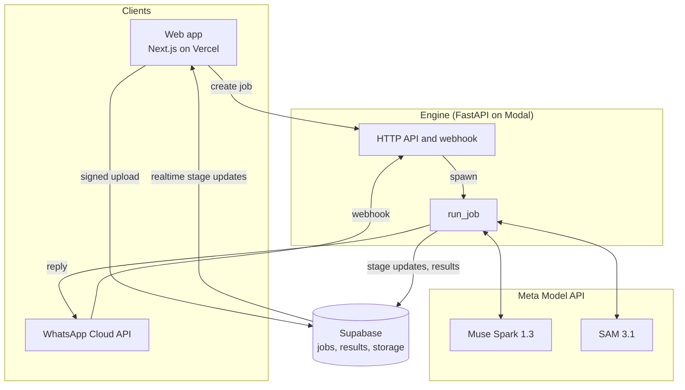

# Architecture

Pisa answers one question about a video: could real physics have produced this motion? Models plan, track and explain. Pure, tested Python code measures and decides.

## Components

Status after day 5: every stage from upload to the evidence video and share card runs locally, end to end in CI, and deployed. The deployed engine uses the free offline stages (whole-clip planner, color segmenter, templated explanations) until paid calls are switched on; the Muse Spark planner and explainer and SAM 3.1 are built and tested offline against the request and response shapes in Meta's documentation; none has been called for real yet. The WhatsApp webhook is next.

### Deployment (all on free plans, no payment method anywhere)

| Piece | Where | Notes |
|---|---|---|
| Web | Vercel, personal team `nanos-projects-ace74675`, project `pisa` (root `apps/web`), public at https://pisa-theta.vercel.app (the address cards and link previews show) and https://pisa-nanos-projects-ace74675.vercel.app | Deploys on every push to `main`. `NEXT_PUBLIC_ENGINE_URL` points at the engine. Vercel login protects preview branches and deployment-specific URLs; the production domains are public. |
| Engine | Modal app `pisa-engine`, `https://nanoulloa--pisa-engine-web.us-east.modal.run` | 1 CPU, at most 2 containers, scales to zero. `make deploy-engine`. Secret `pisa-engine` holds the Supabase URL and secret key and the allowed web origins (both public addresses; any other origin is refused). An hourly function deletes expired evidence videos. |
| Jobs and results | Supabase project `Pisa` (`supabase/migrations`) | RLS on with no policies: only the engine's secret key reads and writes. Videos never reach the database and are deleted from the engine when each job ends. |

Modal hands the engine the real client address as the connection peer and drops forged `X-Forwarded-For` headers (checked on 2026-10-26 by comparing this machine's hashed public IP with the engine's log; the logged hash has since been salted per process, so it no longer matches an unsalted hash and cannot be reversed), so the rate limiter keys on the peer.

## Pipeline

Each stage has typed inputs and outputs from `packages/contracts/schema/pisa.schema.json` and writes its result as JSON, so any stage can be re-run alone from saved artifacts.

| # | Stage | Input → output | Code |
|---|---|---|---|
| 0 | Ingest | upload → `IngestResult` (probes, `Timebase`) | `pisa_engine/ingest` |
| 1 | Plan | normalized clip → `Plan` (events with time windows, phrases, size references, camera notes) | `pisa_engine/planning` |
| 2 | Track | each phrase over its event windows only → `TrackSet` | `pisa_engine/tracking/windows.py` |
| 3 | Stabilize | frames + object boxes → `CameraPath`, `Stabilization`, scene cuts | `pisa_engine/vision/stabilize.py` |
| 4 | Measure | stabilized tracks → flights (phases and bounces) per object and shot | `pisa_engine/physics/trajectory.py` |
| 5 | Test | flights, scale → `TestResult` T1 to T5 | `pisa_engine/physics/suite.py` |
| 6 | Verdict | `TestResult[]` → `Verdict` | `pisa_engine/verdict.py` (policy 0.1.0) |
| 7 | Explain | verdict and measurements → `Explanation` in the job's language, or none | `pisa_engine/explain` |
| 8 | Render | flights, scale, camera path → ghosts, `Evidence` (video kept 24 h, series for charts) | `pisa_engine/render` |

### Ingest

Every video is untrusted input. `normalize()` forces ffmpeg's MP4/MOV demuxer with external data references off, allows only the local-file protocol and passes explicit `file:` URLs, so a playlist or concat script renamed to `.mp4` cannot fetch URLs or read files. It rejects clips with no duration, longer than 60 s or larger than 4096 px, caps the transcode at 60 s whatever the metadata says, then measures the output again.

The output is an H.264 MP4 at a constant frame rate equal to the source average, rotation applied, no audio. Constant frame rate makes `t(frame) = start_s + frame * fps_den / fps_num` exact. SAM 3.1 returns zero-based frame indices of the clip it receives, so this `Timebase` maps its output back to source time.

### Plan

`Planner` is a protocol with two implementations:

- `MuseSparkPlanner` uploads the normalized clip, counts the request's input tokens (`POST /v1/responses/input_tokens`, which includes the video) so the spend guard can hold the true worst case, then calls `POST /v1/responses` with `input_video` sampled at up to 8 frames per second (at most 240 frames in all) and `text.format` set to the `Plan` contract as a strict JSON schema. Reasoning effort is low. The upload is deleted when the call ends.
- `WholeClipPlanner` treats the whole clip as one fall of a fixed phrase, for tests and offline runs.

Every plan goes through `checked()`: windows are clipped to the clip and pulled half a sampling interval inside at both ends, phrases are normalized and deduplicated, implausible sizes are dropped, and a plan that keeps no event becomes "too unclear". The window matters: a test shows that the hand's push before a real toss makes it look impossible, and that the planner's window removes it. Without measurable events the pipeline tracks nothing and the verdict is inconclusive with the planner's reason (`no_free_flight` or `too_unclear`).

The planner never judges whether a video is real; its instructions forbid it. A reference of known size (preferably the moving object itself, such as a ball) gives T4 its scale: a ball's diameter is read from the narrower side of its box, since motion blur only lengthens it along the motion.

### Track

Each phrase is tracked once over the span of its events, cut from the normalized clip frame-exactly (`trim_frames`), since SAM bills per frame. Only samples inside an event window are kept and measured, each window separately. A reference object that is not part of any event is tracked over the first event's window only, to read its size.

`Segmenter` is a protocol with two implementations:

- `Sam31Segmenter` uploads the clip (`POST /v1/files`, deleted afterwards), streams `POST /v1/responses` with model `sam-3.1`, one concept phrase and the `file_id`, and decodes the stream with Meta's `meta-sam-parser`. We keep the latest mask revision per frame and object, decode it to a raster, and compute the centroid and area in source pixels from the mask's bounds.
- `ColorSegmenter` tracks the synthetic ball by color, for tests and offline runs.

### Stabilize

Handheld clips move the frame under the object, which bends its path on screen. `estimate_camera_path` follows corners in the background with pyramidal Lucas-Kanade optical flow (downscaled to 640 px, objects' boxes masked out, a forward-backward check per corner) and fits a similarity transform (shift, rotation, zoom) with RANSAC. Chaining the transforms maps each frame onto the first frame of its shot. A link needs 15 inlier corners and half of the corners that tracked; otherwise the frame is unreliable and the next frame links to the last trusted one. A failed link where the frame's 32 × 32 thumbnail also changes a lot is a scene cut, which starts a new shot. A background with too few corners to follow is taken as a still camera. Below 1 px of motion the tracks are left untouched.

An object with more than 20% of its samples on unreliable frames is not measured (`camera_motion`). The rest are mapped into stable coordinates and split per shot. On rendered clips with 6 to 12 px of hand shake, g comes back within 1% after stabilization and 5 to 8% off without it.

### Physics tests

All are pure functions on arrays (`pisa_engine/physics`). They share one constant-acceleration fit with honest standard errors (`fit.py`), and each convicts only when a difference is both large and many standard errors out.

| Test | Needs | Convicts when | Code |
|---|---|---|---|
| T1 free-fall shape | one flight | the object slows down while falling, accelerates upward, or its acceleration grows (air drag can do none of these) | `shape.py` |
| T2 Galileo pair | two objects released within 50 ms | accelerations differ by 20% or more, at 4 standard errors or more | `pair.py` |
| T3 bounce energy | a bounce | restitution above 1.05, at 4 standard errors or more; speeds are read where the two parabolas meet, between frames | `bounce.py` |
| T4 implied g | a scale in px/m and a true time base | Earth's g is outside the 5 to 95% Monte Carlo interval; never convicts alone | `implied_g.py` |
| T5 time-base consistency | two flights of one object | accelerations differ by 25% or more, at 4 standard errors or more | `consistency.py` |

T1, T2, T3 and T5 need no scale and no true frame rate, so slow motion cannot fool them. The verdict needs confidence 0.9 to convict, which for T2, T3 and T5 means a difference about 9 standard errors past the tolerance. T4 runs only on flights that passed T1, and is set aside when the planner suspects slow motion. Wrong gravity alone leaves the verdict inconclusive, and the page says that slow or fast playback looks the same.

### Explain

`MuseSparkExplainer` sends Muse Spark the facts, never the video: the verdict, and only the measurements a reader understands, already rounded (ratios, the share of speed a bounce keeps, gravity in m/s², a few constants such as Earth's g). It asks for two or three plain sentences in the job's language, with minimal reasoning. The answer is kept only if every number written in it, read in the conventions of its language (decimal comma in Spanish and Portuguese), is one of the facts rounded no more finely than given. Otherwise, or when the call fails or paid calls are off, there is no explanation and the clients use their templated copy, which exists in all four languages. The stage never fails a job.

### Render

`ghosts()` gives every measured flight a ghost: it leaves with its object (same place, same speed, from the object's own fit) and then follows a law. It follows a stricter law only where that law's test found a violation, so on a real clip every ghost runs on top of its object: after a bounce that gains energy, the highest bounce physics allows (`elastic_bounce`); for two objects released together that fall apart, their shared acceleration (`partner`); when a size reference shows gravity that is not Earth's, Earth's gravity at the measured scale (`earth_gravity`); otherwise the closest constant-gravity path (`fit`). Ghosts are ranked by how far they part from their objects, and the result keeps the first six as `EvidenceSeries` for charts.

`render_evidence()` cuts the clip to the measured events plus half a second, plays events shorter than 4 s at half speed, scales to at most 1280 px, and draws the tracked object's two-tone ring, the points measured so far, and the translucent lime ghost with its path. Ghosts live in stabilized coordinates; each frame maps them back through the inverse of its camera transform. Output is H.264 (main profile, at most 2 Mbit/s) under WhatsApp's 16 MB.

The video shows the user's frames, so it follows the raw video's rule: it is kept for 24 hours in the private Supabase bucket `evidence` (16 MB, MP4 only), then deleted through the Storage API by a Modal function that runs hourly, and also swept when jobs arrive. `GET /jobs/{id}/evidence.mp4` answers with a signed link valid for one hour, or 404 once `expires_at` has passed even if the sweep has not run yet. Locally the video stays on disk. `PISA_STORE=local` keeps jobs, results and evidence on disk even when `.env` configures Supabase.

### Share card

The web app draws the card with `next/og` from the stored result, so it uses the same messages, verdict logic (`src/lib/result.ts`) and tokens as the page: the verdict with its shape, the sentence under it, the most telling flight with its ghost on the ink surface, the number that says the most, and the tagline. It holds only derived data, never a frame of the video, so it outlives the evidence video. Two sizes: `/[locale]/result/[id]/card` (1080 × 1350, 4:5, to send as an image) and the result page's Open Graph image (1200 × 630, for link previews). Fonts come from Google Fonts with only the glyphs the card needs, which keeps Chinese out of the 500 KB bundle limit.

### WhatsApp

`POST /whatsapp/webhook` checks Meta's signature on the raw body, answers at once, and hands each message to `WhatsAppBot` in the background (`pisa_engine/whatsapp`). A video (or a video sent as a document) under 16 MB gets an acknowledgment, runs through the same pipeline as an upload, and gets one reply: the evidence video with a caption (verdict, the sentence under it, what the lime circle means, a note when WhatsApp marks the video as frequently forwarded, and the result link). Without an evidence video the reply is text whose link preview shows the share card. Text gets a welcome; anything else, a request for a video. `GET /whatsapp/webhook` answers Meta's subscription check. Both are open without the engine token, since Meta signs instead.

Media is fetched by id (`GET /{media-id}`, a URL valid for 5 minutes) with the access token and streamed with a 16 MB cap. Graph calls are retried with backoff only when a repeat cannot send a message twice. Message ids are claimed once in Supabase, since Meta retries deliveries for days. All copy comes from `apps/web/messages` (namespace `WhatsApp` plus verdicts, errors and explanations), embedded by `make gen`. Setup steps are in [WHATSAPP.md](WHATSAPP.md).

## Meta Model API access

All requests go through `MetaModelApiClient`, which checks two gates before anything leaves the machine:

1. **Data policy.** Each job carries `data_policy: user | internal`. A `-contributor` model (Meta may train on its inputs) is refused unless the policy is `internal`, meaning our own test clips.
2. **Spend guard.** `PISA_PAID_CALLS_ENABLED` is a kill switch, off by default. When on, the worst-case cost of each call is computed from list prices (`model_api/pricing.py`) and checked against a persistent ledger and `PISA_SPEND_CAP_USD`. Meta's own spend limit only sends email alerts, so this is the real stop.

The key is a `SecretStr` read only from `MODEL_API_KEY`, used only in the Authorization header, and redacted from logs.

Uploaded files never expire on Meta's side unless asked, so every upload is deleted (`DELETE /v1/files/{id}`) as soon as its call ends, even when the call fails, and carries a one-hour expiry as a backstop. Token counting is gated like a paid call because it sends the same data. Every settled cost is also collected for the running job and saved in its result's `costs`.

## Testing

- Engine: pytest with an autouse fixture that blocks every non-local network connection. HTTP adapters are tested with `httpx.MockTransport`; SAM parsing uses streams built in Meta's wire format.
- Synthetic clips with known gravity run through ingest and tracking; tests recover g within 1% from pixels.
- Every law has a pass case, a violation case and a false-positive test on hundreds of noisy real trajectories (T1 falls, T2 pairs, T3 bounces with restitution up to 1.0, T5 bounces). None is ever called a violation.
- Rendered clips run through the whole API: a real bounce, a bounce that gains energy, two balls falling together and apart, and a shaky handheld fall and fake, each with the expected verdict and decisive test.
- Web: Vitest checks every locale has the same ICU keys and the agreed core terms; Playwright smoke-tests routing and the language switcher, then uploads five rendered clips to the real engine and checks each verdict, explanation and card.
- CI: ruff, mypy strict, pytest, contract drift, ESLint, tsc strict, Vitest, build, Playwright and gitleaks on every push.

## Job API and limits

`POST /jobs` (multipart: `video`, `locale`) answers 202 with the job and runs the pipeline in the background; `GET /jobs/{id}` returns the job with its current stage; `GET /jobs/{id}/result` returns the `AnalysisResult` once done. Errors are `{"error": {"code", "stage"}}` with codes the web app translates.

ASGI middleware runs before any body is read: a size limit (by header and by counted bytes), the bearer token on every route but `/healthz` when `PISA_ENGINE_TOKEN` is set, and per-client plus global job rates. At most `PISA_MAX_CONCURRENT_JOBS` analyses run at once. See DECISIONS.md for the trade-offs.
