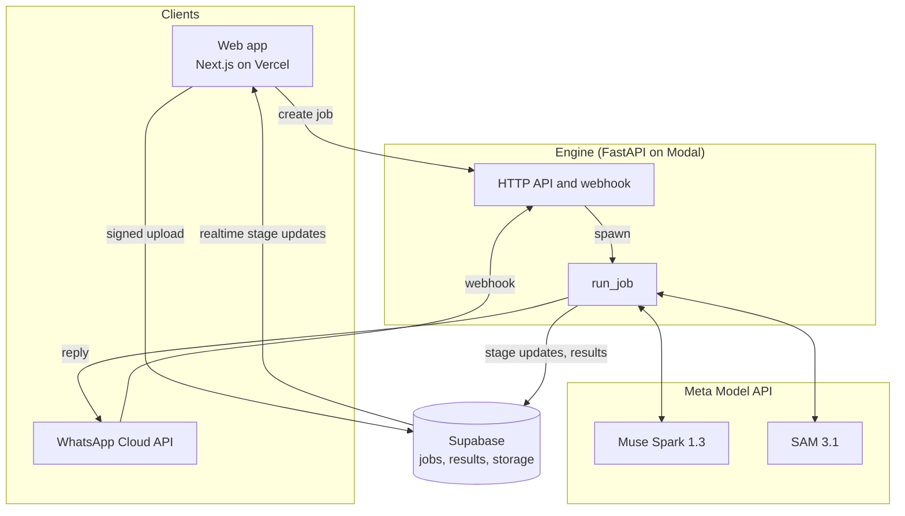

# Architecture

Pisa answers one question about a video: could real physics have produced this motion? Models plan, track and explain. Pure, tested Python code measures and decides.

## Components

Status after day 2: the whole flow (upload, ingest, track, T1, verdict, result page) runs locally and end to end in CI, with a local JSON job store and the free color segmenter. Supabase, Modal, real SAM 3.1 calls, the WhatsApp webhook and the deploys are next.

## Pipeline

Each stage has typed inputs and outputs from `packages/contracts/schema/pisa.schema.json` and writes its result as JSON, so any stage can be re-run alone from saved artifacts.

| # | Stage | Input → output | Code |
|---|---|---|---|
| 0 | Ingest | upload → `IngestResult` (probes, `Timebase`) | `pisa_engine/ingest` |
| 1 | Plan | normalized clip → `Plan` | day 4 |
| 2 | Track | clip + phrase → `TrackSet` | `pisa_engine/tracking` |
| 3 | Stabilize | frames + masks → stable-frame trajectories | day 3 |
| 4 | Measure | `TrackSet` → flight phases | `pisa_engine/physics/trajectory.py` |
| 5 | Test | phases → `TestResult` T1 to T5 | T1 in `pisa_engine/physics/shape.py`; T2 to T5 day 3 |
| 6 | Verdict | `TestResult[]` → `Verdict` | `pisa_engine/verdict.py` (policy 0.1.0) |
| 7 | Explain | `AnalysisResult` → localized text | day 4 |
| 8 | Render | clip + fits → evidence video, share card | day 5 |

### Ingest

Every video is untrusted input. `normalize()` forces ffmpeg's MP4/MOV demuxer with external data references off, allows only the local-file protocol and passes explicit `file:` URLs, so a playlist or concat script renamed to `.mp4` cannot fetch URLs or read files. It rejects clips with no duration, longer than 60 s or larger than 4096 px, caps the transcode at 60 s whatever the metadata says, then measures the output again.

The output is an H.264 MP4 at a constant frame rate equal to the source average, rotation applied, no audio. Constant frame rate makes `t(frame) = start_s + frame * fps_den / fps_num` exact. SAM 3.1 returns zero-based frame indices of the clip it receives, so this `Timebase` maps its output back to source time.

### Track

`Segmenter` is a protocol with two implementations:

- `Sam31Segmenter` uploads the clip (`POST /v1/files`), streams `POST /v1/responses` with model `sam-3.1`, one concept phrase and the `file_id`, and decodes the stream with Meta's `meta-sam-parser`. We keep the latest mask revision per frame and object, decode it to a raster, and compute the centroid and area in source pixels from the mask's bounds.
- `ColorSegmenter` tracks the synthetic ball by color, for tests and offline runs.

## Meta Model API access

All requests go through `MetaModelApiClient`, which checks two gates before anything leaves the machine:

1. **Data policy.** Each job carries `data_policy: user | internal`. A `-contributor` model (Meta may train on its inputs) is refused unless the policy is `internal`, meaning our own test clips.
2. **Spend guard.** `PISA_PAID_CALLS_ENABLED` is a kill switch, off by default. When on, the worst-case cost of each call is computed from list prices (`model_api/pricing.py`) and checked against a persistent ledger and `PISA_SPEND_CAP_USD`. Meta's own spend limit only sends email alerts, so this is the real stop.

The key is a `SecretStr` read only from `MODEL_API_KEY`, used only in the Authorization header, and redacted from logs.

## Testing

- Engine: pytest with an autouse fixture that blocks every non-local network connection. HTTP adapters are tested with `httpx.MockTransport`; SAM parsing uses streams built in Meta's wire format.
- Synthetic clips with known gravity run through ingest and tracking; tests recover g within 1% from pixels.
- Web: Vitest checks every locale has the same ICU keys and the agreed core terms; Playwright smoke-tests routing and the language switcher.
- CI: ruff, mypy strict, pytest, contract drift, ESLint, tsc strict, Vitest, build, Playwright and gitleaks on every push.

## Job API and limits

`POST /jobs` (multipart: `video`, `locale`) answers 202 with the job and runs the pipeline in the background; `GET /jobs/{id}` returns the job with its current stage; `GET /jobs/{id}/result` returns the `AnalysisResult` once done. Errors are `{"error": {"code", "stage"}}` with codes the web app translates.

ASGI middleware runs before any body is read: a size limit (by header and by counted bytes), the bearer token on every route but `/healthz` when `PISA_ENGINE_TOKEN` is set, and per-client plus global job rates. At most `PISA_MAX_CONCURRENT_JOBS` analyses run at once. See DECISIONS.md for the trade-offs.
