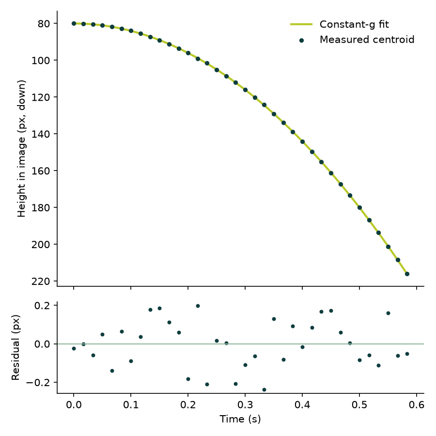

# Spike: SAM 3.1 tracking (2026-10-26)

**Status:** harness built and verified offline. The real SAM 3.1 run waits until the $150 hackathon credits appear in Billing; until then no Meta Model API call is allowed (`PISA_PAID_CALLS_ENABLED=false`).

## What the harness does

`services/engine/spikes/sam/run.py`:

1. Normalizes the clip (constant frame rate H.264, optional time window).
2. Tracks one concept phrase with SAM 3.1, or with the offline color segmenter.
3. Saves the raw SAM stream verbatim (`sam_raw_output.txt`), `track.json` (`TrackSet` contract), a constant-gravity fit with residuals, a trajectory plot and an overlay video.
4. Logs latency per stage and the dollars spent, from the spend ledger.

## Offline results

A synthetic ball rendered at 60 fps, 400 px per meter, moving sideways at 0.8 m/s, tracked from pixels by the color segmenter:

| True g (m/s²) | Measured g | Residual RMS | Frames | Ingest | Track |
|---|---|---|---|---|---|
| 9.81 | 9.811 | 0.117 px | 36 | 0.11 s | 0.04 s |
| 2.00 | 1.998 | 0.119 px | 36 | 0.11 s | 0.04 s |



The 0.12 px residual is the floor of this setup (H.264 at CRF 16 plus binary-mask centroids). Real footage will be noisier; measuring that noise on SAM masks is the first job of the real run.

## Verified without the API

- The request matches the documented shape: model `sam-3.1`, one `input_text` concept phrase plus one `input_video` with a `file_id` from `POST /v1/files` (`purpose: user_data`), streamed.
- Streams built in SAM's wire format (`<Nf>` frame markers, box tokens, base85 masks) decode through `meta-sam-parser` into the expected centroids. Box corners are inclusive on the wire; the parser converts them to half-open bounds, and our centroid math uses those bounds.
- With the kill switch off, the SAM path stops before uploading anything.

## Real run, once credits are applied

Commands (one phrase per call; about $0.06 per 5 s at 60 fps, 50 frames minimum per request):

```bash
uv run --group spikes python services/engine/spikes/sam/run.py eval/raw/drop.mov --segmenter sam --phrase "tennis ball" --start 0.3 --end 2.5
```

Repeat for the throw and the bounce. Expected total for 3 clips with up to 2 phrases each: under $0.50.

Questions this run answers:

1. Does the object keep one id through motion blur and the bounce contact?
2. How much does the SAM mask centroid jitter, in pixels? That is the noise floor for T1.
3. Does the phrase pick the right object when other objects are in frame?
4. Real latency and cost per phrase and window.
5. One Muse Spark call on one clip (contributor tier is allowed for our own footage): video tokens per second, and how accurate its event time windows are.

## Facts from the docs that shaped this

- Base URL `https://api.meta.ai/v1`, Bearer key in `MODEL_API_KEY`.
- SAM 3.1: MP4 or MOV with H.264, H.265 or MPEG-4; up to 15,000 frames and 16 objects per frame; one concept per request; $0.20 per 1,000 frames, minimum 50 frames billed.
- Object ids are stable while an object stays in view but are not dense, and should not be trusted across full occlusion or exit and re-entry.
- Not documented: Muse Spark video tokens per second, its frame sampling rate, and maximum video length. The real run measures them.
